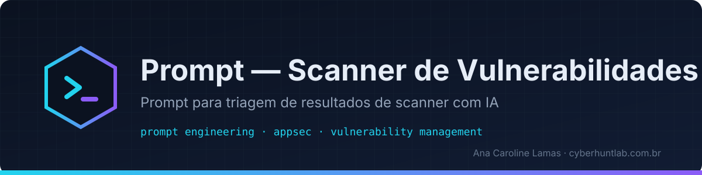

<p align="center"></p>

# Prompt de análise de scanner de vulnerabilidades com IA

**Prompt pronto** para usar com qualquer modelo de linguagem (ChatGPT, Claude, Gemini, DeepSeek, modelos locais) como **analista de segurança defensiva**. Ele transforma a saída bruta de um scanner de vulnerabilidades num **plano de ação**: organiza os ativos, valida as evidências, reduz falsos positivos, prioriza os riscos e indica como corrigir e como confirmar a correção.

O prompt completo está em [PROMPT.md](PROMPT.md).

## O que o prompt faz

O modelo segue cinco etapas:

1. **Identificar e organizar os ativos**: sites, domínios, subdomínios, APIs, servidores e endpoints dentro do escopo.
2. **Validar os resultados**: separar vulnerabilidades confirmadas de possíveis falsos positivos e apontar evidência insuficiente.
3. **Priorizar os riscos**: crítico, alto, médio, baixo ou informativo, considerando impacto, exposição e criticidade.
4. **Definir ações de correção** objetivas para cada achado relevante.
5. **Validar a correção**: como verificar de novo com segurança e atualizar o status.

Cada vulnerabilidade sai num formato padronizado (ativo, tipo, severidade, prioridade, evidência, impacto, confiança, ação, status e validação), seguido de um **resumo executivo**.

## Regras incorporadas

- Não inventar vulnerabilidades, URLs, evidências ou resultados de testes.
- Diferenciar fatos, evidências e hipóteses.
- Manter o foco em segurança defensiva, só em ativos autorizados, sem instruções de exploração.
- Princípio: **"Evidência primeiro. Classificação depois. Conclusão por último."**

## Como usar

1. Copie o conteúdo de [PROMPT.md](PROMPT.md) para o seu assistente de IA.
2. Cole em seguida os resultados do scanner (Nessus, OpenVAS, Nuclei, ZAP, Burp ou outro) e informe o escopo autorizado.
3. Revise o plano gerado antes de agir: a análise depende da qualidade das evidências fornecidas.

```bash
git clone https://github.com/ticarollamas-arch/Prompt.md.git
```

## Tecnologias

Engenharia de prompt · LLMs · Gestão de vulnerabilidades · Segurança de aplicações

## Licença

Distribuído sob a licença MIT. Veja [LICENSE](LICENSE).
